# Evaluación UX con IA_ Métodos_Modernos-2.pdf

Evaluación UX con IA:

Métodos Modernos

Estrategias avanzadas de análisis de

experiencia de usuario y

optimización predictiva.

Métodos de Evaluación UX: Cuándo Usar Cada

Uno y el Poder de la Combinacion

INSPECCION SIMULACIóN IA PRUEBAS CON USUARIOS

Para: Transparencia Para:Consistencia Visual Para: Impacto Emocional Algorítmica

ENFOQUE HiBRIDO:Automatización + Experto

Humano

Garantiza Cumplimiento Acelera Ciclos Reduce Sesgos Normativo(Salud,Finanzas)

Capas de una misma infraestructura de calidad. Regulacion en Peru

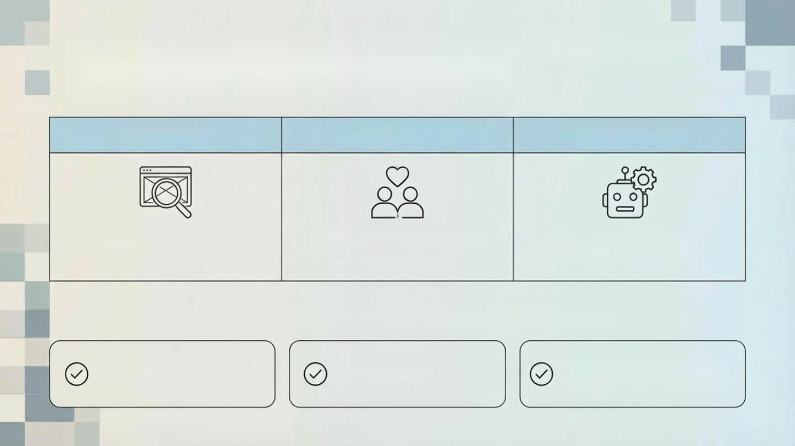

## Nielsen 2024: Nuevas Tendencias UX e IA

### ESTADOS Y MODELOS

SISTEMAS Y ASISTENCIA Y RECUPERACIÓN

### INTELIGENTE

PREDICTIVOS ADAPTABILIDAD

Estados Predictivos: Anticipacion Sugerencias Contextuales: Ayuda Deshacer IA:Reversibilidad de de necesidades del usuario. acciones automatizadas. proactiva en tiempo real.

Revelacion Progresiva con IA: Consistencia de Sistemas de Modelos Mentales Información escalonada. Diseno: Escalabilidad y Multiplataforma:Coherencia en uniformidad. dispositivos. Recuperacion Guiada por LLM: Soporte conversacional avanzado. UI Adaptable: Interfaces Guardrails Predictivos: Seguridad dinámicas según contexto. 0200 en interacciones IA. Ayuda Interactiva tipo Copilot: Colaboración lA-humano.

Aplicaciones Clave: Todo pensado para Chatbots, AR/VR y Apps Moviles.

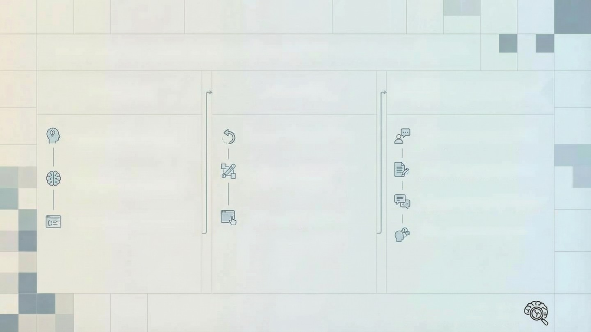

Principios y Checks Esenciales para

Experiencias de IA Éticas

Checks Esenciales para Ética Fundamentos de Confianza y Control

Verificar identidad del modelo Confianza & Previsibilidad & Privacidad & Gestión Transparencia Control Semilla de consistencia

Modo silencio para → interrupciones Revelar Asegura Exigen opt-out interacción consistencia. Evita claros. pop-ups agresivos. con IA. Experiencias de Usuario Éticas y Responsables.

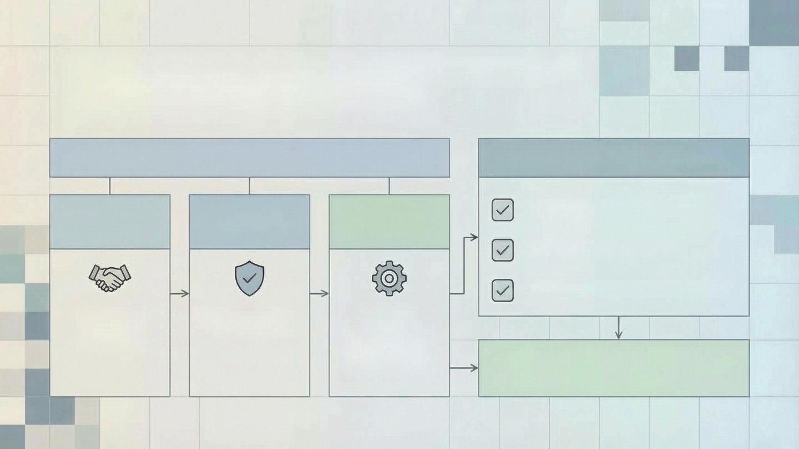

Proceso Hibrido de Evaluacion UX (IA + Humano)

Pre-filtrado con IA Revisión Humana Recálculo de (90 min) (10 min) Severidad

Formula ponderada por Evaluador experto descarta Plugins como UIGenie o falsos positivos y aporta Impacto,Frecuencia, Riesgo de ChatGPT-Vision detectan matices culturales y Dominio y Confianza del Modelo. iniciales. violaciones emocionales.

Confianza del lmpacto Frecuencia Riesgo de Modelo Dominio

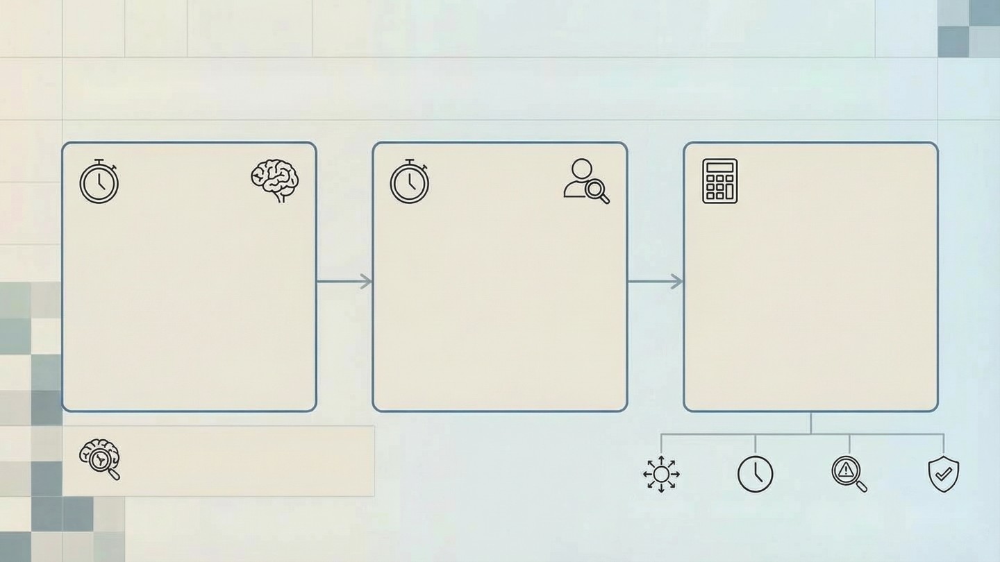

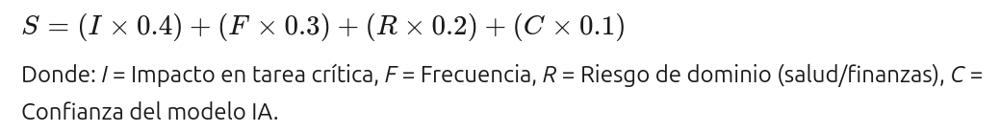

## Métodos de Evaluación UX con IA

### 3. Evaluación de Carga

### 1. Perfiles Sintéticos con 2. Simulacion de Caminos

## Datos de Analytics Cognitivos (LLM) Mental en Miro

Visibilidad

Interpretacion Clarity 2

### Analytics

Evaluacion de data Metas ← →

## hotjar

Perfil LLM Generación de caminos IA Sintético Cognitivos Datos de Simulados Carga Mental Widget IA Comportamiento Estimada IA genera perfiles basados en datos LLM alimentado por datos de Miro con IA calcula la carga mental reales,reemplazando personas herramientas simula la navegación y (NASA TLX) vinculando pantallas y escritas. toma de decisiones del usuario. objetivos.

https://clarity.microsoft.com /

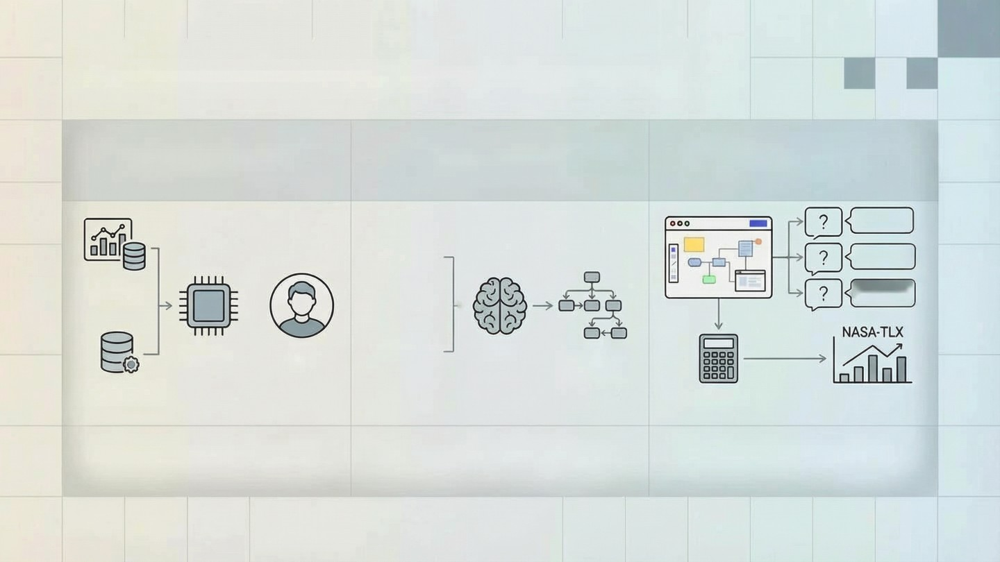

## Visibilidad y Comprension de la Interacción con IA

### Percepción de Acción Manejo de Ambiguedad Reconocimiento de Éxito Parcial

Regenerar Citar Fuente

El usuario nota que puede Reconoce si el objetivo se logró Comprende respuestas actuar con lA? Ejemplos: ambiguas del LLM? parcialmente? Ejemplos: Estado Indicador de escritura, Boton Ejemplos:Citas de fuente, de progreso, Resultados Regenerar Opciones de clarificación parciales

### Verificar visibilidad de funciones invisibles como

autocompletado es critico para flujos sin fricción.

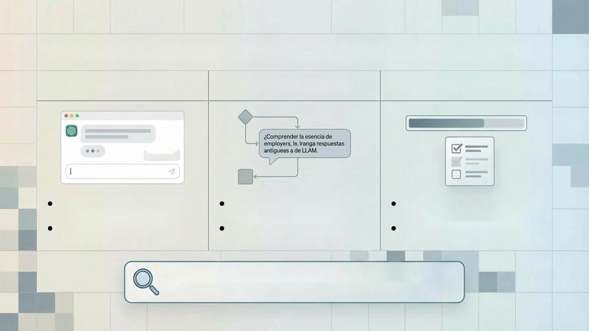

Sesion Asincrona con Stakeholders

Método actual: Evaluación Colaborativa y Eficiente

slack

2. Comentarios en Loom 4. Votación en 1.Grabar 3. Moderación Recorrido Slack con IA

Perspectivas Acelera Consenso de Reducción de Costes Riesgos Multidisciplinarias Logisticos

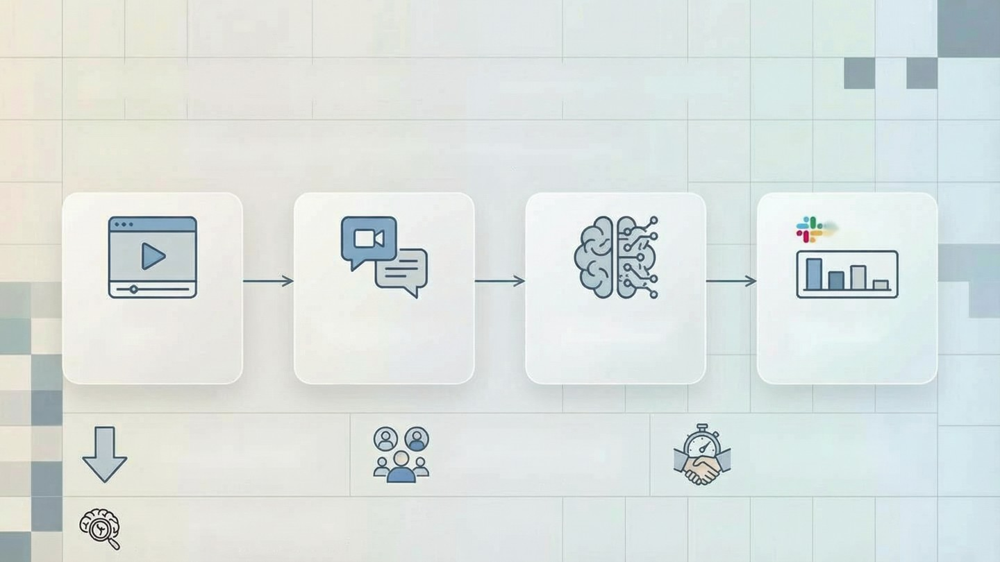

## Evaluacion de Accesibilidad UX: Enfoque Híbrido con IA

### 1. Automatización

### 2. Validacion Experta

### 3. Asistencia con IA

con axe-core

## NVDA

Orden de foco

40% de problemas detectados Control por Voz Auditoria IA Cumplimiento (WCAG 2.2 y EAA) de Contenido Legal Europeo Texto alternativo Navegación Switch

## Detección inicial rapida de Revision humana profunda para

Asegura conformidad en contextos complejos. elementos dinamicos. problemas comunes.

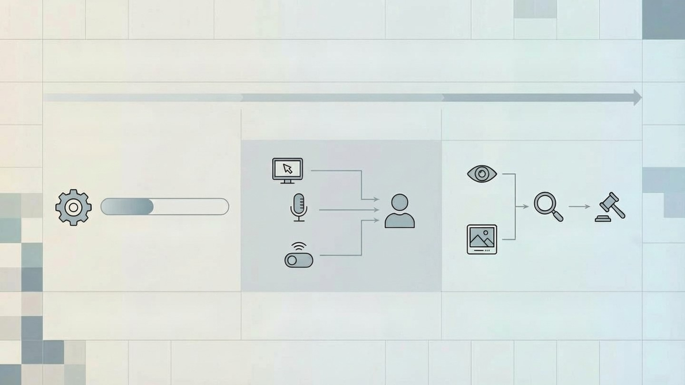

Flujo de Auditoría de Sistema de Diseño con IA

Resultados de la IA

Zeroheight

Tipo de ID de S Storybook Violación Componente Exportación de Figma Análisis con LLM (vs. (API) Material Design 3) Chromatic Al

Código de ldentificar Integracion y Escala (Auditorias Severidad Corrección Inconsistencias de Sistema) (Tokens)

Permite auditorias de sistema de diseño a escala.

https://www.chromatic.com/

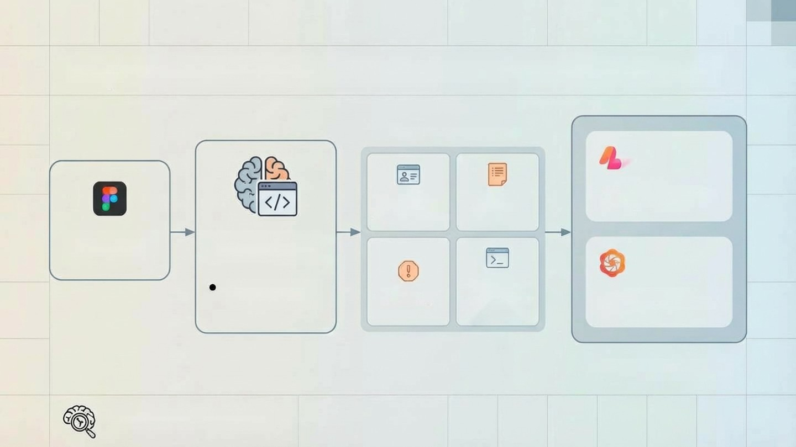

## Adaptación de la Ley de Fitts: Nuevas Modalidades de Interacción

## T = a + b * log (D/W + 1)

### 2

La formula sigue vigente, pero 'D'(Distancia) y W'(Ancho) se redefinen por contexto.

### Swipe (Gestos)

## Voz AR(Ocular)

### Táctil BCI (Cerebral)

D: Distancia en pixeles D: Amplitud del D:Amplitud de sacada D: Separacion entre D:Distancia semantica ocular. W: Ángulo visual del patrones de señal. gesto realizado. entre comandos. al objetivo. W:Tamaño objetivo virtual. W:Claridad y estabilidad W:Claridad y distincion W:Tolerancia del fisico del objetivo tactil. de la señal cerebral. fonética del comando. area y dirección del gesto. words words VS.

## wwm

## Conclusion:Cada contexto redefine el ancho efectivo (W) y la distancia efectiva (D)

para la interaccion.

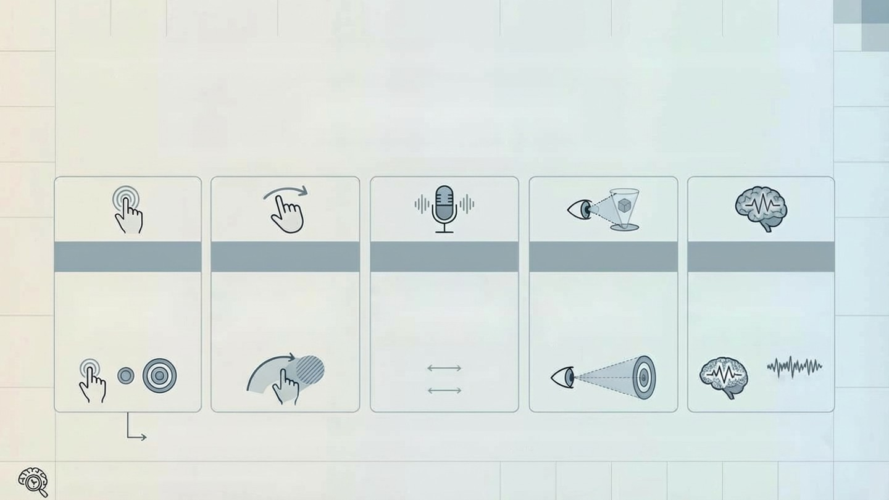

## Evaluación UX en HMI Vehicular: Análisis y Optimización IA

## Enfoque en la seguridad, la eficiencia y la reduccion de la

distraccion.

### Soluciones de Optimizacion IA

### Analisis Predictivo con IA

### Métricas y Parametros Criticos

D:Distancia Ojo-Pantala Simulacion: 1,000 Agrandamiento Contextual Mapas de Calor en Adaptación dinámica según 30s la velocidad y la atención.

Detección de Attention Violaciones y

### Insight

Puntos Criticos Disparo por Voz Interacción manos libres Velocidad > 30 km/h Botón Optimizado para reducir el tiempo de mirada fuera de la carretera.

W:Se maximiza con 10cm La integración de IA reduce Optimizacion del tamaño de los controles Simulacion ultrarrapida para identificar significativamente la distracción, para mayor seguridad a altas riesgos potenciales antes de la mejorando la seguridad vial. velocidades. implementacion.

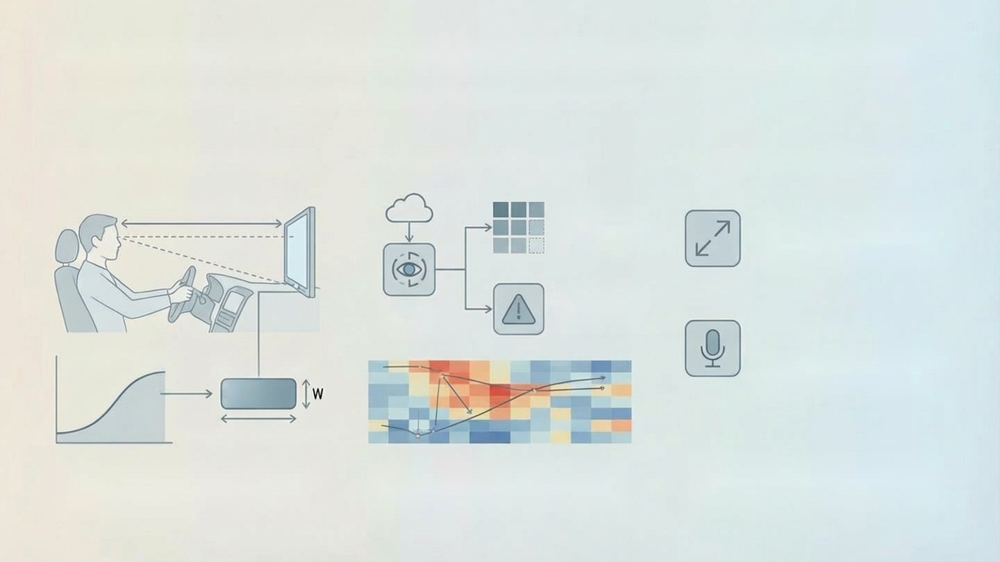

Proceso de Evaluación UX con IA:

Flujo de Trabajo Actual

1. Planificación 2. Ejecucion 3. Análisis 4. Reporte

Miro Al agrupa y categoriza Gamma crea Notion Al genera plan Figma con plugins Clarity y St ark para escaneo heuristico y hallazgos de usabilidad. automáticamente la detallado desde PRD. accesibilidad. BrowserStack presentación de para pruebas en 3,000+ resultados. dispositivos reales. Definición de objetivos y métricas. Airtable sugiere niveles de ChatGPT-Vision analiza severidad basados en datos. Jira auto-genera capturas de pantalla. tickets con fixes priorizados.

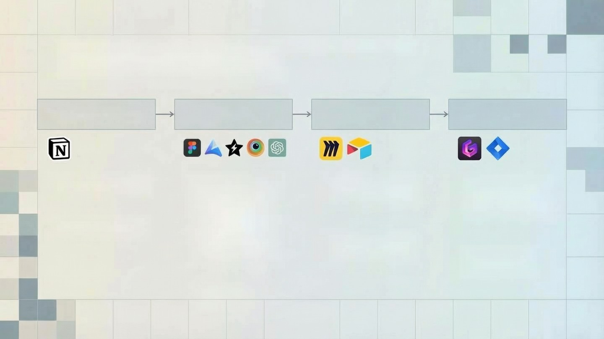

Flujo de Trabajo de Evaluacion UX (5 Días)

Dias 2-3: Evaluación Dia 5:Reporte & Dia 1: Preparacion Dia 4:Consenso Expertos Accion

Maze Mmiro 1h Pm Carga prototipo Generación de O presentacion (Stakeholders)

Debate de Linear severidad Resumen de (Otter.ai) Registro de fixes Pre-escaneo IA consensos

Trabajo distribuido en zonas horarias sin pérdida de contexto

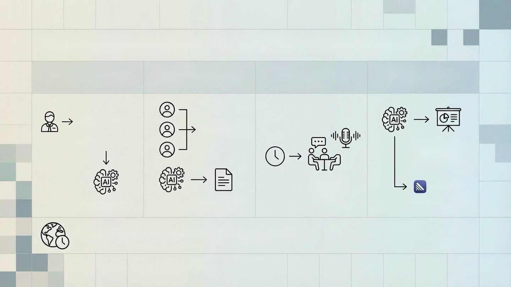

Implementacion de Heuristicas y Prompt

Engineering para Transparencia

Mejora del Control del Diagnostico de Reduccion de Alucinaciones (Prompt Engineering) Transparencia Usuario

Resultado Implementacion Aplicar Heuristicas Intervenciones Clave

Revela falta de Advertencia de Obliga a citar [fuente] en verificación de posibles errores. afirmaciones factuales. fuentes. Botón "Regenerar" Reducción del 35% en tasa para control. de alucinación reportada 35% tras implementacion.

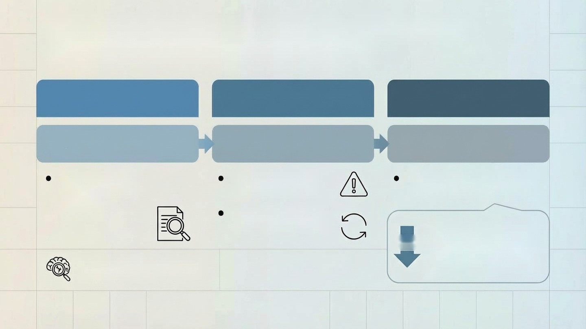

Estudio de Caso: Optimización de Navegación AR con IA

Análisis y Solución Resultados e Impacto Deteccion del Problema

Antes vs. Después

Guardar Ubicación -1.2 s Tiempo de Fitts'Law: Completitud 小 Ángulo mínimo de Antes Después 2°a 2m Comando de voz: Carga 'Save this spot" Cognitiva Alta Baja

Reality Composer Pro + simulacion eye- Tiempo disminuye 1.2 s y reduce Aplicación de Fitts'Law sugiere carga cognitiva en tareas de tracking: BotonGuardar ubicacion" reemplazar interaccion tactil por demasiado pequeño en visión periférica. navegación AR. disparo por voz.

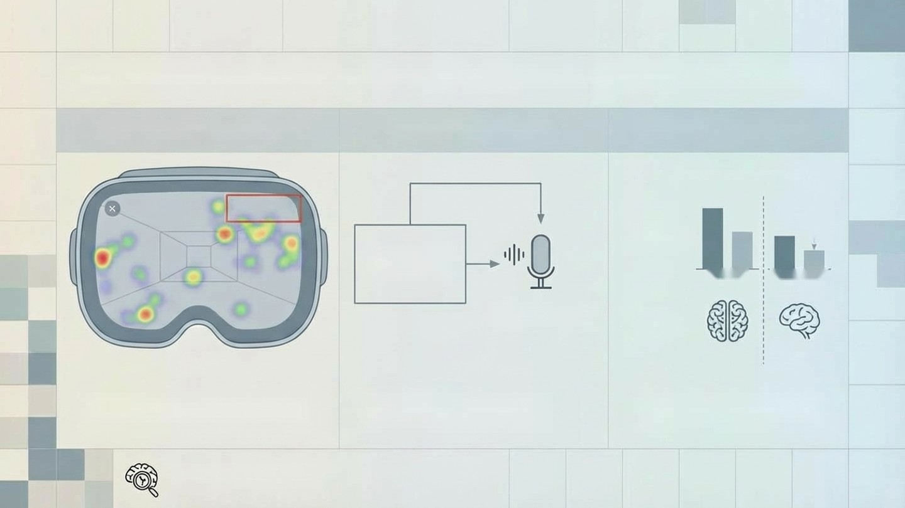

## Riesgos y Limitaciones: UX con IA

Desafios éticos, sesgos ocultos obligaciones de auditora en la evaluacion predictiva.

## AuditoríaObligatoria

## Dependencia e IP

## Completitud y Sego

Falsa Sensacion de Dependencia Completitud: IA Revisar Auditoria de Excesiva:Anula Herramientas. ignora matices pensamiento culturales. critico junior.

Sesgo en Datos de Propiedad Intelectual Diversidad de (IP) : Fixes sugeridos Entrenamiento: Puede Personas pueden plagiar datos de omitir problemas de Sintéticas es entrenamiento. usuarios marginados. Obligatorio.

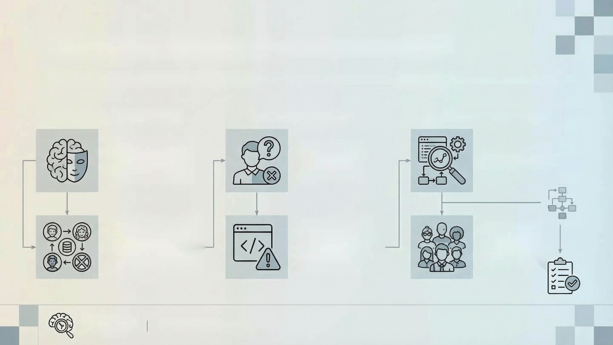

## Tendencias Futuras en Evaluación UX

## Heuristicas

## Generación

## Monitoreo Continuo

## Rol Humano

## Masiva con IA Neuromorficas

## por Agentes

A

Supervisión ética y Nuevos estandares Supervisión 24/7 y Creación y evaluación aprobación de para interfaces cerebro- aprendizaje de métricas en de 1,000 variantes de Lanzamientos computadora (BCI). tiempo real. UI en minutos. responsables.

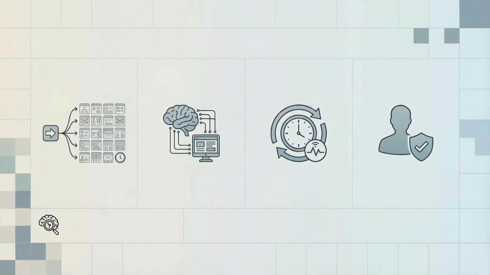

De 'Saber' a Curar':

## La Nueva Era de la Evaluación UX

### Colaboración Estratégica entre Expertos Humanos la Inteligencia Artificial

HUMANO: IA:VELOCIDAD Y CURADOR ESCALA PROFUNDIDAD Y EXPERTO COBERTURA ALGORiTMICA JUICIO

### (Humano)

( IA ) • Escala Algorítmica • Juicio Ético e • Análisis de Datos Masivos Innovación • Detección Rápida de Patrones

### INSPECCIóN UX OPTIMA

• Empatia y Contexto Profundo

• Sabiduria Experta en Diseño ÉTICAMENTE EXPERIENCIAS ACCESIBLES RESPONSABLES SEGURAS

La mejor inspección combina la escala algoritmica y la sabiduría humana para escalar insights sin perder empatía.

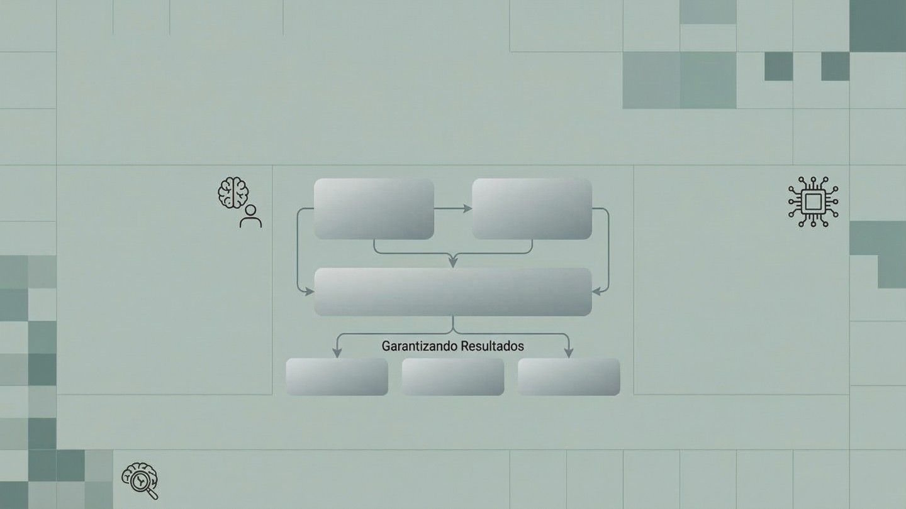
